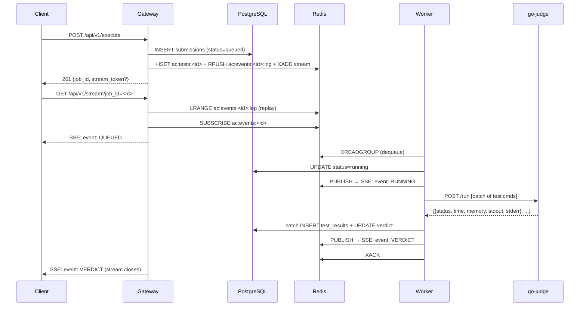

# Architecture

## Overview

AetherCode Execution Engine is a stateless, horizontally scalable code execution service. It accepts HTTP submissions, fans them out to an isolated sandbox via a Redis Streams queue, and delivers verdicts back to the caller over Server-Sent Events.

```
Client
  │
  ▼
HTTP Gateway (Go net/http)
  ├── POST /api/v1/execute    → validate → write DB → enqueue Redis Stream
  ├── GET  /api/v1/stream     → SSE: replay log + subscribe pubsub channel
  ├── GET  /api/v1/health     → DB + Redis + sandbox liveness
  └── GET  /api/v1/languages  → static language catalogue
  │
  ▼
Redis Streams (dual-consumer weighted fair queuing)
  ├── ac:submissions:submit   (weight 3 — graded submit jobs)
  └── ac:submissions:run      (weight 1 — scratch/run-code jobs)
  │
  ▼
Worker Pool (N goroutines, configurable via AC_WORKER_COUNT)
  ├── Fetches submission from PostgreSQL
  ├── Loads test cases (DB for submit / Redis for run)
  ├── Compiles source (compiled langs) → go-judge file cache
  ├── Runs all tests in batched parallel /run calls (up to 32 per batch)
  └── Writes verdict + test results → PostgreSQL + publishes SSE event
  │
  ▼
go-judge sandbox (separate process / container)
  └── Executes each test inside cgroup + namespace + seccomp isolation
```

---

## Components

### HTTP Gateway (`internal/gateway`)

- Single `http.ServeMux` wrapped in middleware layers (outermost first): logging → CORS → OIDC auth → mux.
- `HandleExecute` validates the request, inserts a submission row, stores run-mode test data in Redis, and enqueues the job ID atomically in a single Redis pipeline (`PrepareAndEnqueue`).
- `HandleStream` replays stored events from a Redis list (`ac:events:<jobID>:log`) then subscribes to a Redis Pub/Sub channel for live events. Unauthenticated callers must present a short-lived `stream_token` (20-byte `crypto/rand`, TTL 30 min) issued at submit time.
- `HandleHealth` performs synchronous DB ping, go-judge `/version`, and Redis ping within a 5-second timeout.
- Rate limiting: per-user sliding window (authenticated) + optional per-IP window (unauthenticated, `AC_RATE_LIMIT_UNAUTH_PER_MINUTE`).
- Admission control: rejects submissions when the target stream exceeds `AC_ADMISSION_MAX_QUEUE_DEPTH`.
- Concurrency cap: a semaphore of 512 (`ingestSem`) limits simultaneous handler goroutines to prevent PG pool exhaustion on traffic spikes.

### Queue (`internal/queue`)

- **`DualConsumer`**: weighted fair queuing over two Redis Streams. Each worker goroutine tries `submitWeight` (default 3) messages from the submit stream before one from the run stream. When both are empty, it blocks for `AC_BLOCK_READ_TIMEOUT` (default 500 ms).
- **Reclaimer**: every 30 seconds, `XAUTOCLAIM` re-claims messages idle for >30 seconds and reprocesses them. Messages exceeding `maxDeliveryCount=5` deliveries are dead-lettered (ACKed without processing) and counted in `ac_poison_messages_total`.
- **Legacy drain**: on startup, any messages remaining in the old single stream (`AC_STREAM_NAME`) are drained once and then the goroutine exits.
- **PubSub**: Redis Pub/Sub + list-backed event log for SSE delivery. `PrepareAndEnqueue` pipelines test storage + QUEUED event + stream enqueue in one round trip.

### Worker (`internal/worker`)

- `Start` launches N goroutines. Each is wrapped in a panic-recovery loop that restarts the goroutine after a 1-second backoff.
- **Compile cache**: in-process LRU-like map keyed on SHA-256(language + source). Cache entries expire after `AC_COMPILE_CACHE_TTL` (default 60 s). Avoids recompiling identical source in repeated submissions.
- **Batched execution**: up to 32 tests per `/run` call to go-judge (the `maxBatchSize` constant). go-judge executes the batch in parallel internally, reducing wall-clock time from N sequential round trips to ≈1.
- **Source file caching**: for interpreted languages with >1 test, the source is uploaded once (`BuildCacheSourceCmd`) and subsequent test commands reference it by file ID.
- **Verdict logic**: `JudgeOutput` normalises both expected and actual output (strip trailing whitespace per line, strip trailing blank lines, normalise CRLF→LF) before comparison.
- **Graceful shutdown**: when the context is cancelled, workers finish their current job then exit. Main waits up to 120 seconds for all workers before proceeding with HTTP server shutdown.

### Sandbox Client (`internal/sandbox`)

- Thin HTTP client wrapping go-judge's `/run` and `/version` REST endpoints.
- Connection pool: 128 idle connections, per-request context deadlines, compression disabled (binary sandbox I/O benefits from no compression overhead).
- `BuildCompileCmd`, `BuildRunCmd`, `BuildCacheSourceCmd` construct go-judge `Cmd` objects from the language config. All resource limits (CPU ns, memory bytes, proc count, clock limit = 2×CPU + 1s) are hardcoded per language with optional per-request limit overrides carried with the job's test set.

### Auth (`internal/auth`)

- OIDC JWT validation via `keyfunc` (automatic JWKS refresh). Validates `iss`, `aud`, `exp`, `sub` claims.
- Tenant resolution: maps Zitadel org ID claim (`urn:zitadel:iam:org:id`) → `tenants.id`. Cached for 5 minutes.
- User auto-provision: upserts `users` row on first login. Cached for 5 minutes.
- Role mapping from `urn:zitadel:iam:org:project:roles` claim → `admin` / `faculty` / `student`.
- Optional `AC_DATABASE_APP_URL`: if set, auth middleware uses a second PG pool (connecting as the `aethercode_app` role) for tenant/user queries so RLS policies are enforced.

### Metrics (`internal/metrics`)

All metrics are Prometheus counters/histograms exposed on `127.0.0.1:6060/metrics` (not the public gateway port).

| Metric | Type | Labels |
|--------|------|--------|
| `ac_http_requests_total` | Counter | method, path, code |
| `ac_http_request_duration_seconds` | Histogram | method, path |
| `ac_jobs_processed_total` | Counter | verdict |
| `ac_job_processing_duration_seconds` | Histogram | language, verdict |
| `ac_compile_duration_seconds` | Histogram | language |
| `ac_active_workers` | Gauge | — |
| `ac_queue_depth` | Gauge | stream |
| `ac_rate_limit_rejections_total` | Counter | type (user/ip) |
| `ac_poison_messages_total` | Counter | — |

---

## Submission lifecycle (sequence)



---

## Deployment topologies

### Single node (systemd)
```
[nginx/Cloudflare] → [aethercode-exec :5100] → [go-judge :5050]
                                              → [postgres :5432]
                                              → [redis :6379]
```
See `deploy/aethercode-exec.service` and `deploy/env.example`.

### Kubernetes (multi-replica)
```
[Ingress] → [Service :5100] → [Deployment (2–10 replicas)]
                                    → [go-judge DaemonSet or Deployment]
                                    → [PostgreSQL StatefulSet / RDS]
                                    → [Redis Deployment / ElastiCache]
```
See `deploy/k8s/` for manifests. Workers are stateless — scale the Deployment replicas to add execution capacity. go-judge must run on every node (use a DaemonSet) or as a shared service; in shared-service mode, all workers point at the same `AC_JUDGE_URL`.

---

## Security model

- **Sandbox isolation**: user code executes inside go-judge's cgroup + Linux namespace + seccomp sandbox. The engine never executes user code directly.
- **Tenant isolation**: every submission, problem, and test result is scoped to a `tenant_id` (UUID). The auth middleware resolves the caller's Zitadel org to a tenant. Row-Level Security policies in PostgreSQL enforce tenant boundaries at the DB layer when `AC_DATABASE_APP_URL` is configured.
- **Auth**: OIDC JWT (Zitadel). Callers are unauthenticated trusted backends; every job gets a `stream_token` that gates its SSE stream.
- **Rate limiting**: per-user sliding window (`AC_RATE_LIMIT_PER_MINUTE`) + optional per-IP window for unauthenticated callers. Admission control caps the Redis queue depth.
- **Input validation**: source code ≤ 64 KB, body ≤ 64 MB, test data ≤ 8 MB per case, idempotency key ≤ 255 bytes.
